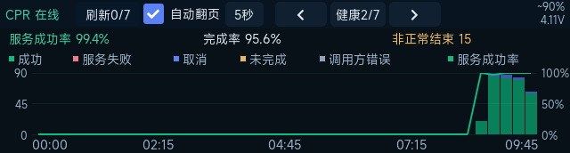
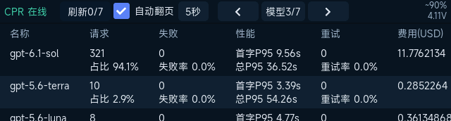

# CPR ESP32 横屏监控器

把 codex-proxy-rs 的请求量、Token、缓存和健康情况放到桌面小屏上。设备通过 WiFi 直连 CPR，不需要电脑常驻采集程序。

适配 **微雪 ESP32-S3-Touch-LCD-3.49B V2**，640×172 横屏触摸，CPR 深蓝主题，MiSans Regular 中文字体。

## 实机画面

### 总览

今日与累计指标、整卡半透明面积图，以及变化数字的逐位翻动。


### 请求健康

服务成功率、完成率、非正常结束数量；15 分钟分桶的结果堆叠柱与成功率曲线。



### 模型诊断

按今天的数据查看模型请求量、失败、性能、重试与费用。



仅公开这三页截图；账号、密钥、错误和请求明细页不提供截图。

## 七页与刷新方式

**总览 → 健康 → 模型 → 账号 → 密钥 → 错误 → 请求明细**，手动和自动翻页均首尾循环。

- 顶部状态栏常驻，显示 CPR 连接、刷新、翻页和设备电量；左右按钮切页，表格上下看行、左右看列。
- 手动浏览时，点击倒计时刷新全部；间隔可选 **10／30／60／120／300／600 秒**，默认 30 秒。切页只使用缓存，刷新进行中不叠加请求。
- 自动翻页每页停留 **3～10 秒**。每轮回到总览时刷新全部，刷新完成后再停满设定时间，便于观看数字翻动；第七屏不等待网络。触摸期间暂停翻页，松手后重新计时。
- 模型、账号、密钥和错误诊断只看今天。账号后显示灰色备注，账号内容最多五个汉字宽，超出省略；其余列按内容扩宽并留白。
- 请求明细使用 `status=all`，显示 **今天最新 10 条请求**：时间、结果、密钥名称、账号、模型、TOKEN、延迟、速率、IP、错误。结果保留成功、失败、取消、未完成等真实状态，无发送状态或点击详情。
- 自动翻页时识别每轮取得的新运维错误，告警显示 5 秒后消失；不额外轮询，不把运维事件拼入请求表。
- “今天”以 CPR 返回的时间为准，跨日清理昨日缓存；失败时保留当日旧数据并显示异常。

## 下载与编译

[Releases](https://github.com/KazeLiu/codex-proxy-rs-esp32-monitor/releases) 提供源码包，包含字库、使用说明和以上三张截图。**需要配置自己的服务器、WiFi 和管理 Key 后编译烧录。** 设备上的私人固件包含凭据，不在公开发行包中。

### 准备

- 硬件为 **3.49B V2**，16 MB Flash、8 MB PSRAM；V1 或其他屏幕需要另行适配。
- 安装 **ESP-IDF 6.1.x**，打开其 PowerShell 终端；首次构建会下载 `idf_component.yml`／`dependencies.lock` 固定的组件。
- 准备 2.4 GHz WiFi、可访问的 CPR HTTPS 地址，以及 **管理 API Key**。普通模型调用 Client Key 不能代替管理 Key。
- CPR 需支持统一请求 `status=all` 及下列管理接口，字段约定见 [设计文档](DESIGN.md#91-接口对应)。

### 第一次烧录

下载源码包并解压，或：

```powershell
git clone https://github.com/KazeLiu/codex-proxy-rs-esp32-monitor.git
cd codex-proxy-rs-esp32-monitor
```

在 ESP-IDF PowerShell 终端执行：

```powershell
.\build.ps1 -Configure -Flash -Port COM3
```

1. 输入管理 API Key，输入不回显。
2. 在 `menuconfig → CPR Monitor` 设置 **CPR base URL、WiFi name、WiFi password**，保存并退出。URL 使用 `https://cpr.example.com` 这样的根地址，可带端口，不带末尾 `/` 或 `/api`。
3. 脚本编译并烧录，成功后删除临时 Key 文件。把 `COM3` 换成设备的实际串口。

以后沿用本机配置，执行 `.\build.ps1 -Flash -Port COM3`。只编译则去掉 `-Flash`；不在 IDF 终端时，可用 `-IdfProfile '你的 ESP-IDF PowerShell 配置脚本路径'` 导入环境。

`firmware/sdkconfig`、`firmware/.private/` 和构建目录只留在本机，已加入忽略规则。构建失败会保留临时 Key 以便继续，完成后可手动删除 `firmware/.private/api-key.txt`。**自行生成的 bin、elf、sdkconfig 和构建日志可能包含凭据，不要上传。**

### 字体与辅助工具

MiSans 字库已随源码提供，无需重新生成。需要调整字号或字符范围时，安装 Node.js，从[小米官网](https://hyperos.mi.com/font/zh/download/)取得 MiSans Regular，再运行 `generate-fonts.ps1 -Font '字体文件路径'`。

- `check-api.cmd`：输入 CPR 地址及管理 Key，一次读取各接口，JSON 按 UTF-8 解码。结果含业务明细，不要直接公开。
- `capture-screen.py --port COM3 --page 1 --output overview.png`：读取设备真实帧缓冲；页码 1～7，不指定页码时不切页。
- `read-console.py --port COM3 --seconds 25`：读取串口日志。两个 Python 工具需要 `pyserial`，可使用 ESP-IDF 自带的 Python；不要同时占用同一串口。

## 机身操作与恢复

- **PWR 短按**：熄屏／亮屏，熄屏后数据继续更新。
- **太阳键短按**：循环 100%、75%、50%、25% 亮度，熄屏时也可亮屏。
- **PWR 长按**：约 0.3 秒开始显示关机进度，2 秒满格，松手后关机；未满格松手则取消，不触发短按。
- **重新开机**：按住 PWR 约 2 秒后松手。电池供电时释放供电保持；USB 供电时用深睡眠实现关机。
- 电量带 `~` 表示按电压估算，每 5 秒更新；20% 及以下提醒低电量。无法读取时显示 `BAT --`，不猜测充电状态。
- 无法烧录时：按住 **BOOT／太阳键**，点按 **RESET**，再松开 BOOT，重新执行烧录。恢复其他固件请使用该固件自己的刷机说明；本项目不执行整片擦除。

已在上述 V2 实机确认短按熄屏／唤醒、亮度、长按取消／关机／再开机，以及纯电池运行。其他硬件修订版尚未确认。

## 源码与许可

- `firmware/main/`：CPR 数据、七页 UI、机身控制、WiFi 与 MiSans 字库。
- [DESIGN.md](DESIGN.md)：页面、接口、刷新规则和硬件参数。
- [CHANGELOG.md](CHANGELOG.md)：版本变化。
- [THIRD_PARTY.md](THIRD_PARTY.md)：硬件示例、组件及字体来源。

项目原创代码采用 [Apache-2.0](LICENSE)。MiSans 字形数据保留小米版权并适用其[独立许可](licenses/MiSans-License.pdf)，不包含在 Apache-2.0 授权范围内。
